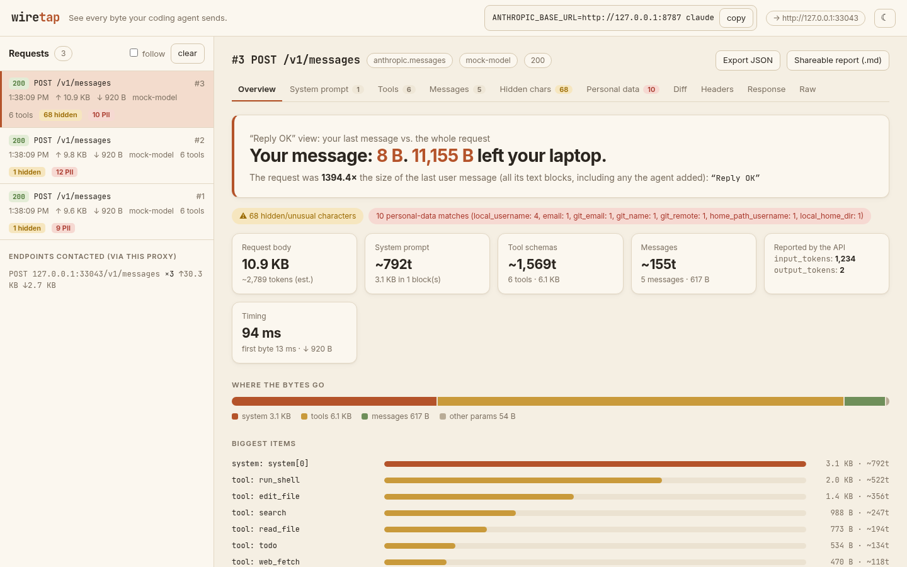
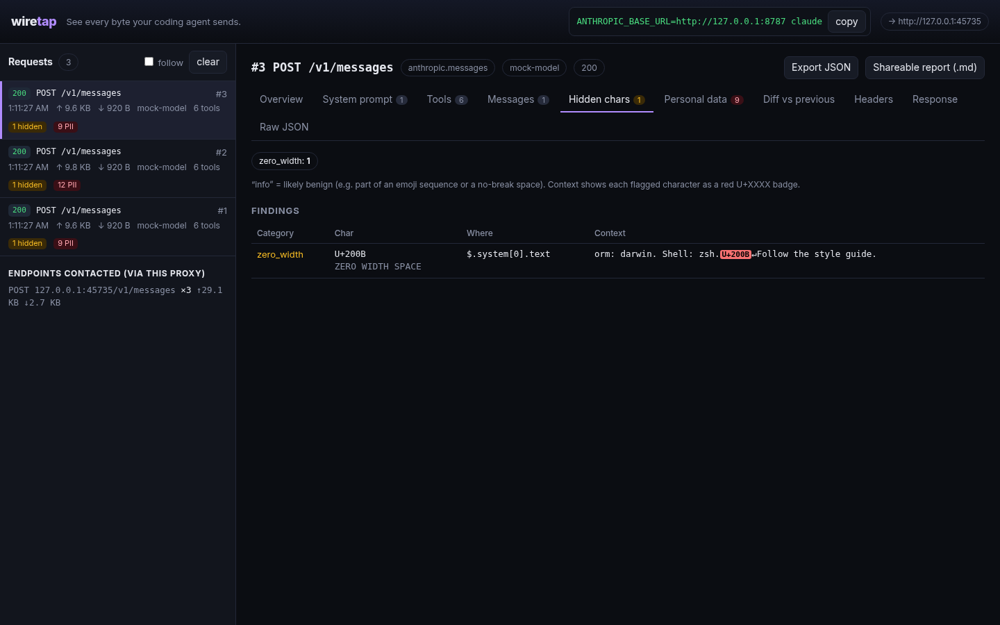
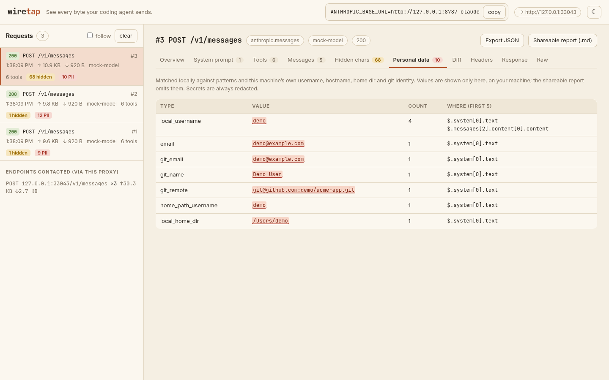
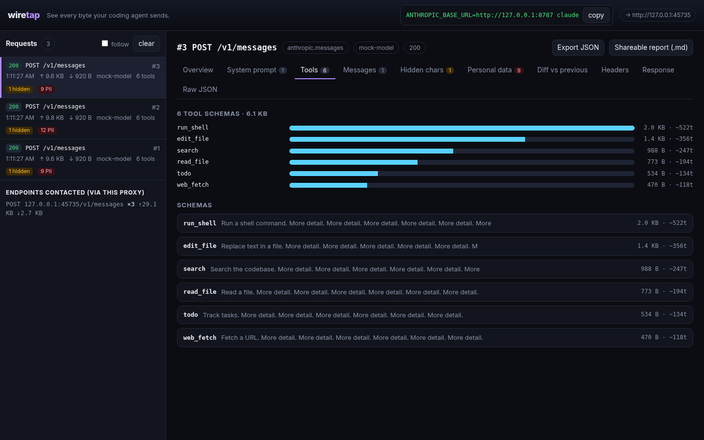
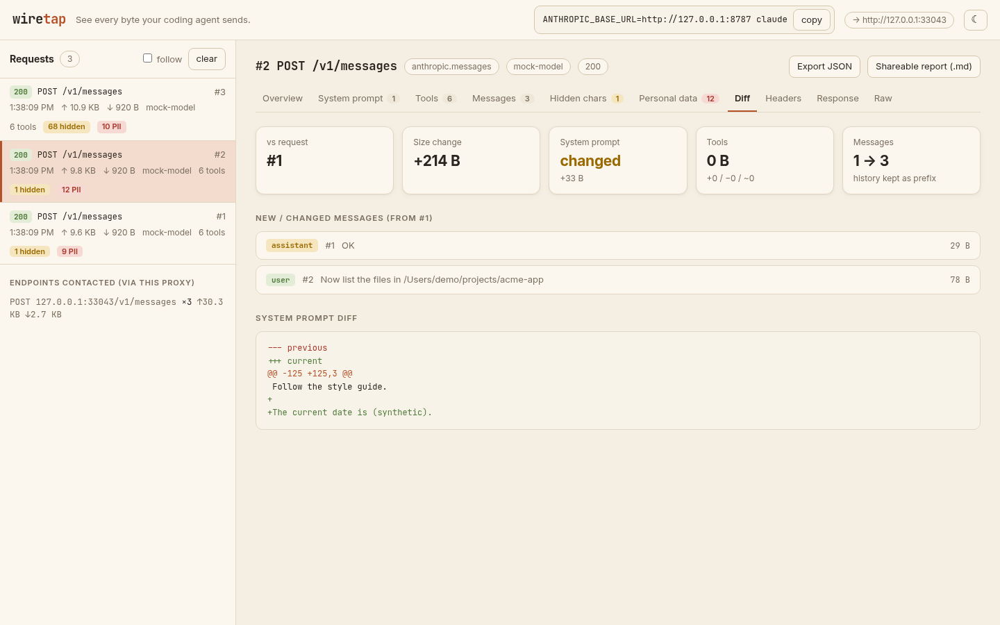

<div align="center">

# wiretap

### See every byte your coding agent sends.

A local proxy + web UI that shows exactly what Claude Code (and other agents) put on the wire:<br>
the system prompt, every tool schema, the whole re-sent history, hidden Unicode, and your personal data.

<a href="https://github.com/pranav-singhal/wiretap/stargazers"></a>
<a href="LICENSE"></a>


**[Quick start](#quick-start) · [What you'll see](#what-youll-see) · [Privacy](#privacy-first) · [Agents](#supported-agents) · [FAQ](#faq) · [Contributing](#contributing)**

<!-- HERO: swap for docs/hero.gif recorded from a real session (see docs/launch-plan.md, pre-launch checklist) -->
<picture>
  <source media="(prefers-color-scheme: dark)" srcset="docs/screenshot-overview-dark.png">
  
</picture>

<sub>You type <code>Reply OK</code>. This is what actually leaves your laptop. (Screenshot from the built-in synthetic demo, not real traffic.)</sub>

</div>

## Why

- Your agent sends far more than your message: a long system prompt, dozens of tool schemas, the full history, every turn.
- That payload can carry things you never see: your email, home paths, git remotes, and invisible characters that the model still reads.
- You can't fix or trust what you can't see. wiretap shows it, on your machine, in one command.

## Quick start

```bash
git clone https://github.com/pranav-singhal/wiretap && cd wiretap && python3 -m wiretap --open
```

```bash
ANTHROPIC_BASE_URL=http://127.0.0.1:8787 claude      # in another terminal
```

Type `Reply OK`, then look at <http://127.0.0.1:8788>. Python 3.9+, standard library only, nothing to install.

> Use `127.0.0.1`, not `localhost`: some Node versions try IPv6 `::1` first, and wiretap listens on IPv4 loopback.
> Claude Code reads `ANTHROPIC_BASE_URL` at launch, so start a new session.

## What you'll see

| | |
|---|---|
| **Size of the ask** | "Your message: 8 B. N B left your laptop." Then how the request splits between system prompt, tool schemas, messages and other params, with the biggest items ranked. |
| **System prompt** | Every system block in full, with size and a token estimate. |
| **Tool schemas** | Every tool the agent advertises (built-in and MCP), ranked by size, with the JSON. |
| **Hidden characters** | What goes *into* the model that you can't see: zero-width characters, bidi overrides, Unicode tag characters (decoded back to readable text), variation-selector runs (decoded), apostrophe lookalikes like `ʼ` U+02BC, Cyrillic letters inside Latin words. Normal curly quotes, emoji and Indic/Arabic joiners are not flagged. |
| **Personal data** | Emails, home-directory paths, git remotes and identity, IPs, key-shaped secrets, plus your own username and hostname, matched locally. |
| **Diff between turns** | What changed since the previous request: system prompt diff, tools added or removed, new messages, whether earlier history was rewritten. |
| **Response** | Streaming responses reassembled: text, tool calls, stop reason, and the API's own reported `usage`. |
| **Export** | Full capture as JSON, or a shareable Markdown report with sizes and counts but no prompt text and no personal values. |

<table><tr>
<td></td>
<td></td>
</tr><tr>
<td></td>
<td></td>
</tr></table>

Beige by default, dark mode one click away (it follows your system setting until you pick).

### Why hidden characters matter

Invisible Unicode can carry instructions a model reads and you don't. In 2024 Johann Rehberger showed Claude reading and following hidden Unicode "tag character" text ([Embrace The Red](https://embracethered.com/blog/posts/2024/claude-hidden-prompt-injection-ascii-smuggling/)); how well current models resist it varies by model and version. The same trick works in MCP tool descriptions, which are re-sent to the model every turn ([arXiv 2607.05744](https://arxiv.org/html/2607.05744)). And from 2.1.91 to 2.1.196, Claude Code itself swapped the apostrophe in "Today's date" for lookalike characters when `ANTHROPIC_BASE_URL` pointed somewhere custom; it was removed in 2.1.197 ([write-up](https://thereallo.dev/blog/claude-code-prompt-steganography), [HN](https://news.ycombinator.com/item?id=48734373)). wiretap flags all of these. We haven't captured that date marker ourselves; it was removed before wiretap existed.

## Privacy first

- **Local only.** Listens on `127.0.0.1`; the UI rejects non-local `Host` headers.
- **Nothing leaves your machine** except the request your agent was already sending, to the upstream you chose. No telemetry, no update checks, no CDN, no fonts.
- **Keys are never shown or saved.** `Authorization`, `x-api-key`, cookies and key-shaped strings are forwarded untouched and redacted everywhere wiretap displays or stores anything.
- **Read-only proxy.** Request bytes and header order are forwarded as received; wiretap observes, it doesn't edit.
- **Memory by default.** The last 200 captures live in RAM. `--save DIR` writes redacted JSONL with `0600` permissions.
- **Small enough to audit.** One Python package and one HTML file, no build step, zero dependencies.

## Supported agents

| Agent | How | Status |
|---|---|---|
| Claude Code | `ANTHROPIC_BASE_URL=http://127.0.0.1:8787 claude` | Tested by the maintainer with a real session |
| Codex CLI (API-key mode) | `wiretap --agent codex`, then `OPENAI_BASE_URL=http://127.0.0.1:8787/v1 codex` | Decoder written, **untested with the real CLI** |
| Gemini API clients | `wiretap --agent gemini`, point the client's base URL at the proxy | Decoder written, **untested** |
| Anything with a configurable base URL | `wiretap --upstream https://your.api` | Raw view, sizes, hidden characters and personal data work for any JSON |

Tried it with another agent? Open a PR adding a row.

## CLI

```
wiretap [--port 8787] [--ui-port 8788] [--agent claude|codex|openai|gemini]
        [--upstream URL] [--save DIR] [--max 200] [--host 127.0.0.1] [--open]
```

`--ui-port -1` serves the UI on the proxy port at `/__wiretap/`. Try the UI with no API key: `python3 scripts/demo.py`.

## FAQ

**Does it see everything my agent does?** No. Only what the agent sends to the base URL you pointed at wiretap (the model API). Other hosts, MCP servers and web fetches don't pass through it.

**Do I need to install a certificate?** No. The agent talks plain HTTP to wiretap on loopback; wiretap makes a normal TLS connection to the real API.

**Does it slow things down?** Responses stream through chunk by chunk; analysis runs after the bytes are forwarded.

**Are the token counts exact?** Counts marked `~` are estimates (bytes ÷ 4). The "Reported by the API" card is exact, from the response's `usage`.

**Will my agent behave differently behind a proxy?** wiretap doesn't change requests, but an agent can tell a custom base URL is set (see the date-marker story above). Treat what you see as what is sent *when proxied*.

**Does Claude hide characters in its replies?** We know of no evidence that it does so on purpose. wiretap scans responses too, but the documented risk is what goes *into* the model.

**How is this different from claude-trace?** [claude-trace](https://github.com/badlogic/lemmy/tree/main/apps/claude-trace) by Mario Zechner records Claude Code sessions into a nice log viewer, and it inspired this. wiretap is a live, zero-dependency proxy for any agent with a base-URL setting, and focuses on accounting and auditing: where the bytes go, diffs between turns, hidden characters and personal data.

**Is this allowed?** You're inspecting your own traffic on your own machine with your own key. Check your provider's terms if you're unsure.

## Limitations

- Only sees traffic sent to the configured base URL; no HTTPS interception of other hosts.
- Brotli/zstd responses pass through but aren't decoded for display (gzip/deflate are).
- Token numbers per section are estimates.
- Codex and Gemini support is untested against the real tools.
- Personal-data matching is pattern-based: it will miss some things and flag some harmless ones.

## Contributing

PRs welcome. See [CONTRIBUTING.md](CONTRIBUTING.md). Run `python3 -m unittest`.

Good first issues:

- Verify and document Codex CLI, Gemini CLI, Aider, Cline, OpenCode or Continue (one row in the agents table each)
- Session view: group requests into a conversation and chart prompt growth per turn
- Cost estimate from the reported `usage`, with a user-supplied price table
- `wiretap report saved.jsonl` to turn a saved capture into Markdown
- Brotli/zstd decoding when the optional module is installed
- Homebrew formula
- Translations of this README (see below)

**Translations:** planned for 简体中文, 日本語, 한국어, Español, Português (BR) and हिन्दी as `README.<lang>.md`, linked from the top. Not started; native speakers welcome.

## Star history

<a href="https://star-history.com/#pranav-singhal/wiretap&Date"></a>

If wiretap showed you something surprising, a star helps others find it.

## License

MIT. See [LICENSE](LICENSE).
