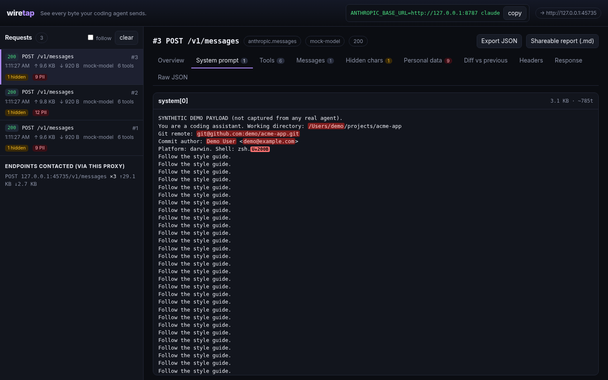

<div align="center">

# wiretap

**See every byte your coding agent sends.**

A local proxy + web UI that shows exactly what Claude Code (and Codex, and other API clients) put on the wire:
system prompt, tool schemas, message history, token estimates, hidden Unicode characters, and anything that looks like your personal data.

One command. Zero dependencies. Nothing leaves your machine except the request you were already sending.

<!-- HERO: replace with docs/hero.gif (see "Make the hero GIF" below) -->


<sub>Screenshot uses the built-in synthetic demo (<code>python3 scripts/demo.py</code>), not real agent traffic.</sub>

</div>

---

## 30-second quick start

```bash
# 1. start wiretap (Python 3.9+, no dependencies)
pipx install agent-wiretap        # or: uvx --from agent-wiretap wiretap   (once published to PyPI)
wiretap --open

# 2. in another terminal, run your agent through it
ANTHROPIC_BASE_URL=http://127.0.0.1:8787 claude
```

Type `Reply OK`. Open <http://127.0.0.1:8788>. Look at what actually went out.

From a clone, no install at all:

```bash
git clone https://github.com/OWNER/wiretap && cd wiretap
python3 -m wiretap --open
```

> Use `127.0.0.1`, not `localhost`: some Node versions resolve `localhost` to IPv6 `::1` first, and wiretap binds IPv4 loopback by default.

## What it shows

For every request, computed only from the bytes it captured:

| View | What you get |
|---|---|
| **What left your laptop** | Request size, and how it splits between system prompt, tool schemas, messages and other params, with the biggest items as bars |
| **"Reply OK" view** | Your last message's size vs. the whole request ("your message: 8 B, N B left your laptop"); counts all text blocks in that message, including any the agent added |
| **System prompt** | Every system block, full text, size and ~token estimate |
| **Tools** | Every tool schema ranked by size, expandable JSON |
| **Messages** | Full history the agent re-sends each turn, per message size |
| **Hidden characters** | Zero-width, bidi overrides, Unicode tag characters (decoded), variation selectors, control and private-use chars, unusual spaces, mixed-script "homoglyph" words, highlighted inline with a count |
| **Personal data** | Emails, home-directory paths, git remotes, IPs, key-like secrets, plus *your own* username, hostname, home dir and git name/email (read locally once, used only for matching) |
| **Diff vs previous** | What changed since the last request to the same endpoint: system prompt diff, tools added/removed/changed, new messages, whether earlier history was rewritten |
| **Headers** | Request and response headers, credentials redacted |
| **Response** | Streaming (SSE) responses reassembled: text, tool calls, stop reason, event counts, and the API's own reported `usage` |
| **Endpoints** | Every method + path sent through the proxy, with bytes up/down |
| **Export** | Full capture as JSON, or a **shareable Markdown report** with sizes and counts but no prompt text and no personal values |

Token numbers marked `~` are estimates (bytes ÷ 4). Numbers labelled *reported* come from the API's response.

<table><tr>
<td></td>
<td></td>
</tr><tr>
<td></td>
<td></td>
</tr></table>

## Privacy guarantees

wiretap is built to be safe to run on your real work:

- **Forwards to one place only**: the `--upstream` you configured (default `https://api.anthropic.com`). No telemetry, no update checks, no analytics, no CDN assets in the UI. The UI's Content-Security-Policy only allows connections back to wiretap itself.
- **Doesn't alter requests**: body bytes, header names, case, order and duplicates are forwarded as received. The only changes are `Host` (must name the upstream) and hop-by-hop headers like `Connection`, which HTTP defines as per-connection.
- **Never shows or saves credentials**: `Authorization`, `x-api-key`, cookies and any header with key/token/secret/auth in its name are forwarded untouched but redacted everywhere wiretap displays or stores data. Key-shaped strings inside bodies (Anthropic/OpenAI/GitHub/AWS/Slack/Google keys, private keys, bearer tokens) are redacted too.
- **Local only**: listens on `127.0.0.1`. The UI rejects requests whose `Host` isn't local (DNS-rebinding guard).
- **Memory by default**: the last 200 captures live in RAM and vanish when you quit. `--save DIR` appends redacted captures to a JSONL file created with `0600` permissions. Those files still contain your prompts and personal data; don't commit them (`*.jsonl` is in `.gitignore`).
- **Small and auditable**: standard library only, about 1,350 lines of Python and one HTML file, no build step.

## Supported agents

| Agent | How | Status |
|---|---|---|
| Claude Code | `ANTHROPIC_BASE_URL=http://127.0.0.1:8787 claude` | Primary target; Anthropic Messages API decoder and SSE parser tested against a mock |
| Codex CLI (API-key mode) | `wiretap --agent codex` then `OPENAI_BASE_URL=http://127.0.0.1:8787/v1 codex` | Decoder for Responses and Chat Completions; **not yet tested with the real CLI** |
| OpenAI-compatible clients | `wiretap --upstream https://api.openai.com` and point the client's base URL at `http://127.0.0.1:8787/v1` | Same decoders |
| Gemini API clients | `wiretap --agent gemini` and point the client's base URL at the proxy | Decoder for `generateContent`; **untested**; depends on the client exposing a base-URL override |
| Anything else over HTTP(S) with a configurable base URL | `wiretap --upstream https://your.api` | Raw view, headers, sizes, hidden chars and PII work for any JSON |

Something not decoding nicely? Decoders are ~30-line functions. See [CONTRIBUTING.md](CONTRIBUTING.md).

## CLI

```
wiretap [--port 8787] [--ui-port 8788] [--agent claude|codex|openai|gemini]
        [--upstream URL] [--save DIR] [--max 200] [--host 127.0.0.1] [--open]
```

- `--ui-port -1` serves the UI on the proxy port at `/__wiretap/`.
- `--upstream` may include a base path, e.g. `https://my-gateway.example/anthropic`.
- `WIRETAP_PORT` / `WIRETAP_UI_PORT` env vars set the default ports.

## FAQ

**Does wiretap see everything my agent does?**
No. It sees what the agent sends to the base URL you point at wiretap: the model API calls. Anything the agent sends elsewhere (other hosts, MCP servers, web fetches, telemetry or update checks if any) does not go through it. The *Endpoints* panel lists only what passed through the proxy.

**Does it slow things down?**
Responses are streamed through chunk by chunk as they arrive; analysis runs on a background thread after the bytes are forwarded.

**Is it a MITM? Do I need to install a certificate?**
No. Your agent talks plain HTTP to wiretap on loopback; wiretap opens a normal TLS connection to the real API with your system's trusted CA store. Nothing to install.

**Will my agent behave differently behind a proxy?**
wiretap doesn't modify requests, but an agent can tell it was given a custom base URL. We haven't verified whether any agent changes behaviour when one is set.

**Are the token counts exact?**
Section-level counts are estimates (bytes ÷ 4). For exact input/output tokens, see the *Reported by the API* card, which comes from the response's `usage` field.

**Why is the response "encoded" sometimes?**
If an API compresses its response with Brotli or zstd, wiretap passes the bytes through untouched but can't decode them for display with the standard library alone. gzip and deflate are decoded.

**Why "personal data" and not "PII leak"?**
Because wiretap reports what is in the payload, not why. Your working directory or git email being in a request may be exactly what you'd expect. The point is that you can see it.

## Make the hero GIF / screenshots

```bash
python3 scripts/demo.py               # mock upstream + 3 synthetic requests, UI on :8788
bash scripts/screenshot.sh            # headless Chrome -> docs/screenshot-*.png
```

For the GIF, record a real session (your own machine and account): run `wiretap --open`, run `claude` through it, type `Reply OK`, and capture the UI updating (e.g. macOS `Cmd+Shift+5`, then convert with `ffmpeg -i in.mov -vf "fps=12,scale=1200:-1" docs/hero.gif`). Check the personal-data tab before publishing anything you recorded.

## Roadmap

- [ ] Verified recipes for Claude Code, Codex CLI, Gemini CLI, Aider, Cline, Continue, OpenCode
- [ ] Session view: group requests into conversations, chart prompt growth per turn
- [ ] Cost estimate from reported usage (user-supplied price table)
- [ ] "Compare two agents" side-by-side for the same task
- [ ] Brotli/zstd decoding when the optional module is installed
- [ ] Optional HTTPS forward-proxy mode for clients without a base-URL setting
- [ ] `wiretap report` CLI to turn a saved JSONL into a Markdown summary
- [ ] Homebrew formula and single-file release

## Contributing

PRs welcome, especially **decoders** for new agents/APIs (small pure functions, one test each) and new hidden-char or personal-data detectors. See [CONTRIBUTING.md](CONTRIBUTING.md). Run the tests with `python3 -m unittest` (or `pytest`).

## License

MIT. See [LICENSE](LICENSE).
